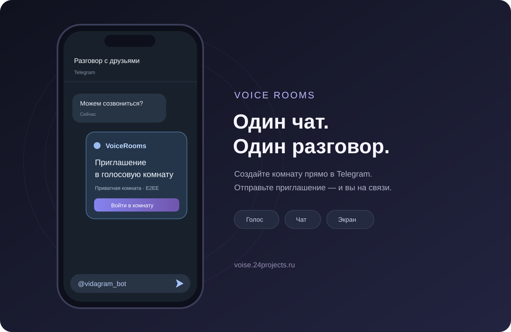

# VoiceRooms

**Голосовая комната прямо из переписки.** Напишите [@vidagram_bot](https://t.me/vidagram_bot) в любом чате Telegram и отправьте предложенное приглашение. На сайте можно создать комнату без регистрации.

**Автор:** Андрей Суховский · [Salatik-s](https://github.com/Salatik-s). Личный проект, разработанный самостоятельно.

[Открыть VoiceRooms](https://voise.24projects.ru/) · [Telegram-бот](https://t.me/vidagram_bot) · [Портфолио автора](https://24projects.ru/people/andrey)

> Тестовая версия. Домен подготовлен для нового развёртывания. Публикация исходников не означает, что сервер уже обновлён.



## Что работает

- Создание приватных комнат на сайте и через inline-режим Telegram.
- Вход по приглашению с ключом, голос, чат и демонстрация экрана в поддерживаемом браузере.
- Сквозное шифрование приватного аудио, экрана и чата средствами LiveKit.
- Передача файлов до 10 МБ: шифрование AES-GCM на клиенте, доступ в течение 5 минут.
- Имя участника внутри конкретной комнаты; автоматический псевдоним при первом входе.
- Управление создателем: запрет публикации, удаление участника, завершение разговора.
- Публичные комнаты для входа без приватного приглашения.

Временная комната действует 4 часа. Базовая конфигурация для небольшого сервера — **до 8 участников в комнате**. Это ограничение конфигурации, а не результат нагрузочного теста на 150 человек.

## Быстрый сценарий

1. В любом чате введите `@vidagram_bot` и выберите приглашение.
2. Получатели открывают его через бота или в браузере.
3. Нажмите «Войти в разговор» и разрешите микрофон. Можно остаться слушателем.

Создателю комнаты из Telegram следует входить кнопкой Mini App в личном чате с ботом: так сервер проверит его права. В обычном браузере участник получает отдельную гостевую сессию. Гостевая сессия привязана к вкладке; после её закрытия права создателя не восстанавливаются из одной общей ссылки.

## Приватность

Приватные комнаты и публичные комнаты имеют разные режимы защиты:

| Данные | Приватная комната | Публичная комната |
| --- | --- | --- |
| Аудио и экран | E2EE поверх транспорта | Транспортное шифрование |
| Чат | E2EE | Транспортное шифрование |
| Файлы | AES-GCM до загрузки | Загрузка отключена |
| Имена, состав и служебные запросы | Доступны серверу | Доступны серверу |

Ключ приватной комнаты находится в части приглашения после `#key=` и не передаётся HTTP-серверу сайта. При создании через Telegram ключ формирует бот; приглашение проходит через Telegram. Любой получатель полной ссылки может войти в комнату. Это **не обещание абсолютной анонимности** и не защита от записи разговора другим участником.

Владелец сервиса отображается участникам как «Владелец сервиса». Серверные права не позволяют расшифровать приватный разговор без его ключа. Запись звонков в приложении не предусмотрена.

На обычном сайте Telegram SDK не загружается; он подключается только в контексте Mini App. Сервер не записывает текст чата или содержимое медиапотоков. Метаданные временных комнат удаляются после установленного срока хранения; для системных журналов и резервных копий нужны отдельные настройки эксплуатации.

Подробнее: [реализация защиты](docs/SECURITY-MODEL.md), [правила и конфиденциальность](frontend/src/Legal.tsx). Юридические страницы пока являются проектом документов: сведения об операторе необходимо оформить перед публичной эксплуатацией. Ссылка для обращений — [24projects.ru](https://24projects.ru/).

## Код проекта

Весь опубликованный код можно читать прямо на GitHub:

| Часть | Основные файлы |
| --- | --- |
| Сайт | [App.tsx](frontend/src/App.tsx), [Call.tsx](frontend/src/Call.tsx), [client.ts](frontend/src/client.ts) |
| API и права | [index.js](backend/src/index.js), [security.js](backend/src/security.js), [telegram-auth.js](backend/src/telegram-auth.js) |
| Данные | [Prisma schema](backend/prisma/schema.prisma), [миграции](backend/prisma/migrations) |
| Telegram | [bot.py](bot/bot.py) |
| Запуск | [compose.yaml](compose.yaml), [инструкция](docs/DEPLOYMENT.md) |
| Портфолио | [карточка проекта](deploy/portfolio-project.mjs), [безопасное добавление](deploy/portfolio-apply.mjs) |

Пример клиентского включения шифрования:

```ts
const keyProvider = new ExternalE2EEKeyProvider();
await keyProvider.setKey(invitationKey);
const room = new Room({ encryption: { keyProvider, worker } });
await room.setE2EEEnabled(true);
await room.connect(mediaUrl, shortLivedToken);
```

Токен звонка получается отдельным запросом после проверки сессии. Он не размещается в приглашении. Параметры вроде `isAdmin=true` из браузера не дают серверных прав.

## Проверки

```powershell
cd backend
npm ci
node --test test/security.test.js
cd ../frontend
npm ci
npm run build
cd ..
python -m venv .venv
.venv\Scripts\python.exe -m pip install -r bot/requirements.txt
.venv\Scripts\python.exe -m unittest discover -s bot -p "test_*.py"
.venv\Scripts\python.exe -m unittest discover -s deploy -p "test_*.py"
node --test deploy/test-portfolio.mjs deploy/test-portfolio-apply.mjs
node --test frontend/test/admission.mjs
```

Проверка с настоящими PostgreSQL и LiveKit выполняется отдельно, **только на изолированной базе `voicerooms_test`**:

```powershell
node --env-file=C:/path/to/private-test.env backend/test/integration.mjs
```

См. [результаты и ограничения проверки](docs/VERIFICATION.md). Для сетей, блокирующих прямой WebRTC-трафик, требуется отдельная настройка TURN; базовый запуск не заявляет универсальную работу во всех корпоративных сетях.

## Изменения и обсуждение

Ошибки и предложения можно оставлять в [Issues](https://github.com/Salatik-s/VoiseRooms/issues). Публичность репозитория не даёт посетителям права изменять его ветки: доступ на запись выдаётся автором отдельно. Копия или fork не меняют этот репозиторий и работающий сайт.

Исходники опубликованы для ознакомления. Общая лицензия на использование и распространение проекта не предоставляется; см. [COPYRIGHT](COPYRIGHT).
